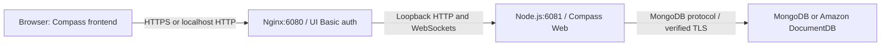

# Architecture

Return to the [README](../README.md), [configuration reference](configuration.md), or [contributor guide](../CONTRIBUTING.md).

## Runtime

The browser renders the Compass Web frontend. A Node.js application serves its HTML, assets, APIs, and database WebSocket transport. Nginx authenticates all application requests before forwarding them to the loopback-only backend. No display server, Electron process, desktop streaming, or remote-desktop client is involved.

The browser database driver uses the `/mongo` WebSocket to carry MongoDB protocol traffic. The server owns the actual TCP/TLS socket. Server-side API operations use the Node.js MongoDB driver. Browser HTTPS and database TLS are separate connections.

## Startup and supervision

1. Python resolves environment variables and mounted secrets using the existing connection validator.
2. The DocumentDB profile validates every TLS configuration source and the effective CA bundle.
3. A private JSON file carries connection settings and server-owned TLS material paths to Node.js. Credentials are not placed in command arguments.
4. Nginx starts with a private salted password hash. UI credentials and raw connection variables are removed from the child environment.
5. Node.js starts on loopback port 6081. Nginx publishes authenticated HTTP port 6080.

The supervisor forwards termination to Node.js first, keeping the gateway available while connections close. It then stops Nginx. A required process exiting makes the supervisor exit so Kubernetes can restart the container. Health checks verify both HTTP services without depending on database availability.

## Browser integration and TLS

The original browser server contains transport and storage behavior that this project adapts in [prepare_web.py](../scripts/prepare_web.py). The build verifies the expected integration points so the reviewed transport and storage hooks are always applied.

The integration replaces the original socket handler with [mongo-proxy.cjs](../app/mongo-proxy.cjs), which accepts only host/port and transport selection from the browser. It rejects cross-origin browser sockets and malformed frames. In the DocumentDB profile it forces TLS, uses the configured server CA/client certificate, and verifies the actual destination hostname. Browser-supplied insecure flags or replacement trust material cannot override those settings.

The embedded shell and its native runtime import are disabled. Server-side certificate paths/passwords are removed from browser connection responses. Generic MongoDB supports editable connections; DocumentDB disables editing. Authenticated UI users still receive database credentials for the browser driver and share the configured database privileges.

## Build and dependency integrity

An official Node.js build stage installs `web/package-lock.json` with `npm ci`, integrity checking, and install scripts disabled. A targeted `@fastify/static` override fixes [CVE-2026-15074](https://github.com/fastify/fastify-static/security/advisories/GHSA-83w8-p2f5-377r); its compatibility is covered by browser/API tests. The runtime remains Ubuntu 26.04 with a copied Node.js binary and locked application dependencies. No third-party Compass Docker image is used.

The npm manifest/lock and package license notices ship with the image. The Node build stage tracks the official `node:24` tag. `make build` pulls current base images and uses a BuildKit npm download cache. The npm manifests are the single source of the browser package version. Python is installed only in the final stage, where it applies the reviewed browser integration. Rebuild with current dependencies and OS updates; see [Automation](automation.md).

## State and repository map

Browser preferences live in browser storage. Environment-defined connections are recreated at startup. Manually added connections are in memory unless a storage password enables encrypted files under `/home/compass/.config`; mount that directory for persistence.

| Path | Purpose |
| --- | --- |
| [Dockerfile](../Dockerfile), [web/](../web/) | Runtime build and pinned npm dependencies |
| [app/server.py](../app/server.py) | Configuration, private runtime JSON, supervision, shutdown |
| [app/connection.py](../app/connection.py) | URI building, mounted secrets, DocumentDB startup policy |
| [app/web.cjs](../app/web.cjs), [app/mongo-proxy.cjs](../app/mongo-proxy.cjs) | Browser bootstrap and server-owned database transport |
| [app/ui_auth.py](../app/ui_auth.py), [app/nginx.conf](../app/nginx.conf) | Authenticated HTTP/API/WebSocket gateway |
| [app/healthcheck.py](../app/healthcheck.py) | Local gateway/application health |
| [app/check_connection.py](../app/check_connection.py) | On-demand database ping with the configured credentials and TLS policy |
| [k8s/examples/](../k8s/examples/) | Standalone deployment manifests |
| [scripts/](../scripts/), [tests/](../tests/) | Build/publish/scan helpers and regression/integration checks |

Tests cover the actual browser server, MongoDB authentication/insert/read through the WebSocket transport, generated TLS and encrypted client-key fixtures, wrong-host/untrusted-CA failures, read-only operation, and encrypted persistence. Live EKS/Istio/DocumentDB access remains environment-specific.
