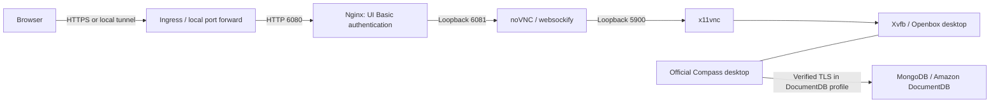

# Architecture

Return to the [README](../README.md), [configuration reference](configuration.md), or [contributor guide](../CONTRIBUTING.md).

## What runs in the container

This repository runs the official Compass Linux desktop application on a virtual X display. noVNC presents that desktop in a browser. It does not rebuild Compass as a web application or run a MongoDB database server.

For a local run, Docker's loopback-bound published port replaces the ingress. Browser HTTPS terminates at the ingress or reverse proxy; the provided Istio example uses HTTP from ingress to the app. Database TLS is a separate connection made by Compass.

| Component | Responsibility |
| --- | --- |
| `tini` and Python supervisor | Forward signals, launch processes, handle child exits, and shut down the desktop |
| Xvfb and Openbox | Virtual display and window management |
| Compass | Database client, connection editor, queries, and desktop preferences |
| x11vnc | Expose the desktop over VNC on loopback only |
| noVNC and websockify | Browser client and WebSocket-to-VNC bridge on loopback only |
| Nginx | HTTP Basic authentication for UI assets and WebSockets on port 6080 |

## Startup and shutdown

1. The supervisor resolves environment variables and supported mounted secret files.
2. The connection helper builds a private Compass connection import file. In the DocumentDB profile it rejects insecure TLS settings and validates the CA bundle before launching the desktop.
3. UI credentials are required and converted to a salted password hash for Nginx. UI credentials are removed from the child-process environment.
4. The display, window manager, VNC service, WebSocket bridge, gateway, and Compass are launched and supervised.
5. On termination, Compass receives up to 10 seconds to save its profile while the display remains available. Infrastructure processes then receive up to 5 seconds to stop.

The supervisor exits if a required child process stops, allowing Kubernetes to restart the container. Probes check the gateway, internal noVNC server, and VNC handshake. They do not test database connectivity or guarantee that a query will succeed.

## State and identity

The runtime uses UID/GID 10001. Temporary files live under `/tmp` and the Compass home directory; saved preferences live under `/home/compass/.config`. The Kubernetes examples provide writable mounts for these locations while keeping the image filesystem read-only.

Persistent storage is optional. Three Kubernetes examples use temporary settings; the persistent example mounts an EBS-backed PVC at the configuration directory. Compose uses a named settings volume by default. Direct Docker runs retain settings in the container's writable layer until the container is removed.

UI credentials grant access to the desktop, while database credentials grant access to the database. The application has no independent per-browser desktop session or user authorization layer. Read [Security](../SECURITY.md) for the deployment boundaries.

## Repository map

| Path | Purpose |
| --- | --- |
| [Dockerfile](../Dockerfile) | Base image, verified Compass installer, AWS CA bundle, and runtime packages |
| [app/connection.py](../app/connection.py) | Connection configuration, secret files, and DocumentDB TLS policy |
| [app/desktop.py](../app/desktop.py) | Process supervision and graceful shutdown |
| [app/ui_auth.py](../app/ui_auth.py), [app/nginx.conf](../app/nginx.conf) | UI authentication and proxy configuration |
| [app/healthcheck.py](../app/healthcheck.py) | Local infrastructure health probe |
| [compose.yaml](../compose.yaml) | Local browser access and persistent settings |
| [k8s/examples/](../k8s/examples/) | Standalone Kubernetes/EKS deployment examples |
| [scripts/](../scripts/) | Build, publish, schema validation, scanning, and Compass upgrades |
| [tests/](../tests/) | Unit tests and opt-in real desktop smoke tests |
| [.github/workflows/](../.github/workflows/) | Shared verification, scheduled scanning, and upgrade pull requests |

## Verification boundaries

Unit tests cover configuration, authentication, supervision, release pins, reports, and script behavior. Container smoke tests exercise the actual desktop, HTTP and WebSocket authentication, secret files, health probes, shutdown, and settings persistence. Schema checks validate the supplied Kubernetes and Istio resource shapes.

These checks do not establish compatibility with every DocumentDB feature, verify a live EKS cluster, or test a particular ingress/network configuration. Validate those in your environment. See [Operations](operations.md) for checks after deployment.
